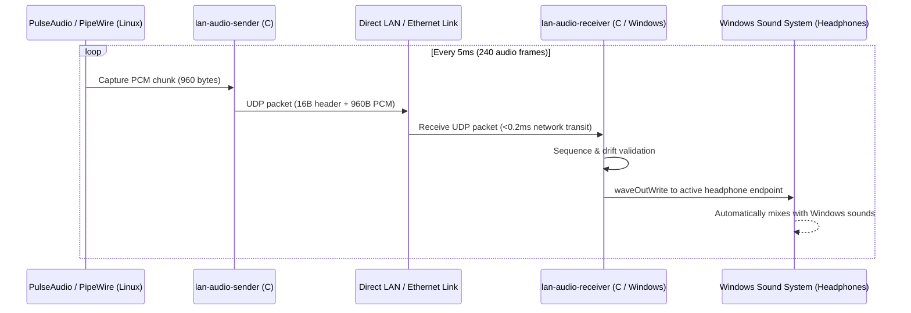

# LAN Audio Bridge (`lan-audio-bridge`)

[](LICENSE)
[]()
[]()

Ultra-low latency, lightweight audio streaming bridge written in **pure C** for sharing a single pair of headphones/speakers between Linux and Windows machines over a local network or direct Ethernet link.

[中文文档 (README_CN.md)](README_CN.md)

---

## Why LAN Audio Bridge?

When using dual-machine setups (e.g., Linux Mini-PC for development + Windows Laptop for office/media) with KVM software like Barrier or Synergy, you often end up with keyboard and mouse shared across screens, but **audio separated**.

Existing audio sharing tools suffer from significant issues:
- **AudioRelay / SoundWire**: Closed-source, subscription paywalls, heavy Java/Electron runtimes.
- **VoiceMeeter / Virtual Audio Cables**: Complex driver installations, audio crackling, high CPU usage.
- **RTP / PulseAudio network modules**: High buffering latency (50-200ms), noticeable delay when watching videos or coding.

**LAN Audio Bridge solves this:**
- **Zero Heavy Dependencies**: Written entirely in pure C (`libpulse-simple` on Linux, WinMM `waveOut` on Windows).
- **Sub-10ms Latency**: 5ms PCM packets + uncompressed UDP transmission (<0.2ms over direct cable).
- **Native Hardware Mixing**: Directly outputs to Windows default audio endpoint (headphones) via `waveOut`; Windows handles hardware mixing automatically with zero extra drivers.
- **Clock Drift Compensation**: Gracefully handles clock variance between independent soundcards to guarantee zero desync even after days of continuous operation.
- **Minimal Footprint**:
  - Linux Sender: **~1.1 MB RAM, <0.1% CPU**
  - Windows Receiver: **~12 MB RAM, <0.1% CPU**

---

## Architecture

```text
+-----------------------------+                 +-----------------------------+
|    Linux Machine (Sender)   |                 |   Windows Host (Receiver)   |
|                             |                 |                             |
|  Desktop Audio Output       |                 |  WinMM waveOut Engine       |
|            |                |                 |            |                |
|  PulseAudio / PipeWire      |                 |  Hardware Shared Mixer      |
|  (@DEFAULT_MONITOR@)        |                 |            |                |
|            |                |   2.5G / 1G     |            v                |
|  lan-audio-sender (Pure C)  |   UDP :4010     |  lan-audio-receiver.exe     |
|  - 48kHz, 16-bit, 2ch       | --------------> |  - Ring buffer (32 slots)   |
|  - 5ms chunks (960 bytes)   |    < 0.2ms net  |  - Drift compensation       |
|  - Packet sequencing        |                 |  - Direct Headphone output  |
+-----------------------------+                 +-----------------------------+
```



---

## Benchmarks

| Metric | LAN Audio Bridge | AudioRelay | VoiceMeeter + VBAN |
| :--- | :--- | :--- | :--- |
| **End-to-End Latency** | **~7 - 10 ms** | 40 - 80 ms | 25 - 50 ms |
| **Linux RAM Usage** | **1.1 MB** | 120 MB (Electron) | N/A |
| **Windows RAM Usage** | **12 MB** | 85 MB | 45 MB |
| **CPU Usage** | **< 0.1%** | 1.5 - 3.0% | 1.0 - 2.5% |
| **Virtual Drivers Needed** | **None** | Yes | Yes (VB-Cable) |
| **License** | **MIT (Open Source)** | Proprietary / Paid | Proprietary |

---

## Quick Start

### 1. Build from Source

Requirements:
- Linux: `gcc`, `make`, `libpulse-dev`
- Windows cross-compilation (on Linux): `mingw-w64` (`x86_64-w64-mingw32-gcc`)

```bash
# Clone the repository
git clone https://github.com/hsdgb3524-crypto/lan-audio-bridge.git
cd lan-audio-bridge

# Build both Linux sender and Windows receiver
make all
```

This produces:
- `bin/lan-audio-sender`: Linux native ELF binary
- `bin/lan-audio-receiver.exe`: Windows PE binary

---

### 2. Manual Run

#### On Windows (Receiver):
```cmd
lan-audio-receiver.exe -p 4010 -b 32
```

#### On Linux (Sender):
```bash
./bin/lan-audio-sender -t <WINDOWS_IP> -p 4010
```

---

### 3. Automatic 24/7 Background Service Setup

#### Linux (Systemd User Service):
Run the automated installation script:
```bash
./scripts/install-linux-service.sh
```
This installs the binary to `/usr/local/bin/lan-audio-sender`, registers `lan-audio-sender.service`, and enables it to autostart upon login.

#### Windows (Scheduled Task, Invisible Console):
1. Copy `bin\lan-audio-receiver.exe` and `scripts\run_hidden.vbs` to `D:\LanAudio\`.
2. Run `scripts\install-windows-task.bat` as Administrator.
3. The receiver will now automatically start at Windows logon and run completely invisibly in the background.

---

## Command Line Options

### Sender (`lan-audio-sender`):
```text
Usage: lan-audio-sender [OPTIONS]
Options:
  -t, --target <ip>      Target IP address (default: 169.254.123.131)
  -p, --port <port>      Target UDP port (default: 4010)
  -d, --device <name>    PulseAudio capture device (default: @DEFAULT_MONITOR@)
  -r, --rate <hz>        Sample rate in Hz (default: 48000)
  -f, --frames <count>   Frames per UDP packet (default: 240, ~5ms)
  -v, --verbose          Enable verbose output
  -h, --help             Show this help message
```

### Receiver (`lan-audio-receiver.exe`):
```text
Usage: lan-audio-receiver.exe [OPTIONS]
Options:
  -p <port>       UDP listen port (default: 4010)
  -b <buffers>    Number of ring buffers, 8-128 (default: 32)
  -v              Enable verbose stats logging
  -h              Show this help message
```

---

## License

This project is licensed under the [MIT License](LICENSE).
