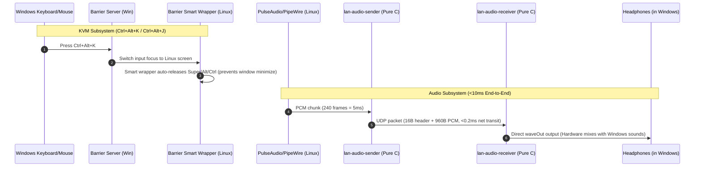

# LAN Desk Bridge (`lan-desk-bridge`)

[](LICENSE)
[]()
[]()

All-in-One Dual-PC workspace bridge for Linux (Development Workstation / Mini-PC) and Windows (Primary Host / Laptop) over a local network or direct 2.5G/1G Ethernet cable.

Combines seamless **KVM (Keyboard, Mouse, Clipboard & Hotkey switching)** with **Ultra-Low Latency Audio Streaming (<10ms)** to share a single pair of headphones/speakers between both machines.

[中文完整文档 (README_CN.md)](README_CN.md)

---

## The Problem: The Dual-PC Workspace Dilemma

When using dual-computer setups (e.g., Linux Mini-PC for coding + Windows Laptop for office/media), creators and developers typically struggle with two major pain points:
1. **Broken KVM Edge Cases**: Standard Barrier / Synergy setups suffer from:
   - **Stuck Modifiers**: Pressing hotkeys to switch screens passes `Alt` / `Super` / `Ctrl`, causing windows to minimize or stick in Linux.
   - **High-DPI Mouse Traps**: The mouse gets permanently stuck at screen coordinates (e.g., `(2559, 1079)`) on high-resolution displays (125%/150%/200% scaling).
   - **CapsLock Flapping**: CapsLock states rapidly desynchronize between Windows and X11.
2. **Audio Separation**: You have your mouse and keyboard crossing seamlessly, but **sound is split**:
   - Commercial tools (AudioRelay, SoundWire) require subscription paywalls or heavy Electron/Java runtimes.
   - Virtual sound cards (VoiceMeeter, VB-Cable) require complex driver installation, cause popping, and introduce 30-80ms of latency.

---

## The Solution: LAN Desk Bridge

**LAN Desk Bridge** provides a battle-tested, unified, lightweight suite:

```text
+-----------------------------------------------------------------------------------------+
|                                    LAN DESK BRIDGE                                      |
+-----------------------------------------------------------------------------------------+
|  [Subsystem 1: Ultra-Low Latency Audio Bridge]                                          |
|    - Pure C implementation (zero Python / Electron / Java runtimes)                     |
|    - Linux sender: captures PulseAudio/PipeWire monitor stream                          |
|    - Windows receiver: WinMM waveOut automatically mixes directly into headphones       |
|    - 5ms chunks (960B) over direct UDP (<0.2ms ping) = sub-10ms total latency           |
|    - Built-in clock drift compensation & auto-reconnect                                 |
+-----------------------------------------------------------------------------------------+
|  [Subsystem 2: Zero-Bug KVM & Hotkey Synchronization]                                   |
|    - Preconfigured Barrier configuration with instant hotkeys:                          |
|        Ctrl + Alt + K  -->  Enter Linux Client                                          |
|        Ctrl + Alt + J  -->  Return to Windows Host                                      |
|    - Smart X11 client wrapper: auto-releases stuck modifiers & auto-syncs CapsLock      |
|    - Windows High-DPI registry fix: prevents cursor trapping on scaled monitors          |
+-----------------------------------------------------------------------------------------+
|  [Subsystem 3: 24/7 Silent Background Daemon & One-Click Operations]                    |
|    - Linux: managed via systemd user services (autostarts on boot)                     |
|    - Windows: managed via Scheduled Tasks & VBScript (zero console windows)             |
|    - Desktop Shortcut: single-click "重启双机协同(键鼠+音频).bat" restarts everything   |
+-----------------------------------------------------------------------------------------+
```



---

## Benchmarks & Resource Footprint

| Metric | LAN Desk Bridge | AudioRelay + Barrier GUI | VoiceMeeter + Synergy |
| :--- | :--- | :--- | :--- |
| **Audio Latency** | **~7 - 10 ms (Imperceptible)** | 40 - 80 ms | 25 - 60 ms |
| **Total Linux RAM** | **~3.9 MB** (Sender 1.3M + KVM 2.6M) | 180 MB | N/A |
| **Total Windows RAM** | **~29 MB** (Receiver 12M + KVM 17M) | 165 MB | 90 MB |
| **Combined CPU Usage** | **< 0.1%** | 2.5 - 4.5% | 2.0 - 4.0% |
| **Extra Drivers Required** | **None** (Native WinMM) | Yes | Yes (VB-Cable) |
| **Console Window Popup** | **None (100% Silent)** | GUI Windows | Tray / GUI |

---

## Directory Structure

```text
lan-desk-bridge/
├── audio/                          # Pure C Low-Latency Audio Subsystem
│   ├── include/
│   │   └── protocol.h              # Shared UDP packet header & audio spec
│   └── src/
│       ├── sender_linux.c          # PulseAudio/PipeWire monitor capture (Linux)
│       └── receiver_win.c          # WinMM waveOut mixer receiver (Windows)
├── kvm/                            # Dual-PC KVM & Modifier Sync Subsystem
│   ├── config/
│   │   └── barrier.conf            # Preconfigured Barrier config with hotkeys & CapsLock fix
│   ├── scripts/
│   │   ├── barrier-client-wrapper.sh # Smart X11 modifier release & CapsLock synchronization
│   │   └── fix_mouse_dpi.reg       # Windows High-DPI mouse boundary trap fix
│   └── service/
│       └── barrier-client.service  # Systemd user unit for Barrier client
├── scripts/                        # Unified Lifecycle & Management Scripts
│   ├── install-all-linux.sh        # One-click installer for Linux (KVM + Audio)
│   ├── install-all-windows.bat     # One-click installer for Windows (KVM + Audio)
│   ├── restart-dual-pc.bat         # One-click desktop restarter for Windows (KVM + Audio)
│   ├── restart-dual-pc.sh          # One-click terminal restarter for Linux (KVM + Audio)
│   ├── lan-audio-sender.service    # Systemd unit for audio sender
│   └── run_hidden.vbs              # Silent execution helper for Windows
├── Makefile                        # Top-level Makefile for audio binaries
├── LICENSE                         # MIT License
├── README.md                       # English documentation
└── README_CN.md                    # Chinese documentation
```

---

## Quick Start

### Step 1: Build the Audio Subsystem (Linux)

```bash
git clone https://github.com/hsdgb3524-crypto/lan-desk-bridge.git
cd lan-desk-bridge
make all
```

This compiles:
- `bin/lan-audio-sender`: Linux ELF binary (native)
- `bin/lan-audio-receiver.exe`: Windows PE binary (cross-compiled via `mingw-w64`)

---

### Step 2: One-Click Linux Setup

Run the Linux installer:
```bash
./scripts/install-all-linux.sh
```
This automatically:
- Checks and installs system dependencies (`barrier`, `xdotool`, `xset`, `libpulse-dev`).
- Installs `lan-audio-sender` and `barrier-client-wrapper.sh` to `/usr/local/bin`.
- Installs and enables `barrier-client.service` and `lan-audio-sender.service` as user systemd units.
- Starts both services immediately.

---

### Step 3: One-Click Windows Setup

1. Copy the `lan-desk-bridge` folder (or `bin\lan-audio-receiver.exe` and `scripts\`) to Windows.
2. Right-click and run `scripts\install-all-windows.bat` as Administrator.

This automatically:
- Copies configuration files to `D:\Barrier\` and `D:\LanAudio\`.
- Applies the High-DPI registry patch to prevent mouse trapping.
- Opens firewall rules for Barrier (TCP 24800) and Audio (UDP 4010).
- Creates scheduled tasks `BarrierServer` and `LanAudioReceiver` that start silently upon login with zero console windows.
- Creates a desktop shortcut: `重启双机协同(键鼠+音频).bat`.

---

## Daily Operation & Hotkeys

| Action | How-to |
| :--- | :--- |
| **Switch to Linux screen** | Press `Ctrl + Alt + K` on your keyboard |
| **Switch back to Windows screen** | Press `Ctrl + Alt + J` on your keyboard |
| **Listen to Linux sound** | Automatic! Sound seamlessly mixes into headphones on Windows |
| **Restart both KVM & Audio (Windows)** | Double-click `重启双机协同(键鼠+音频).bat` on Desktop |
| **Restart both KVM & Audio (Linux)** | Run `./scripts/restart-dual-pc.sh` |

---

## License

This project is licensed under the [MIT License](LICENSE).
