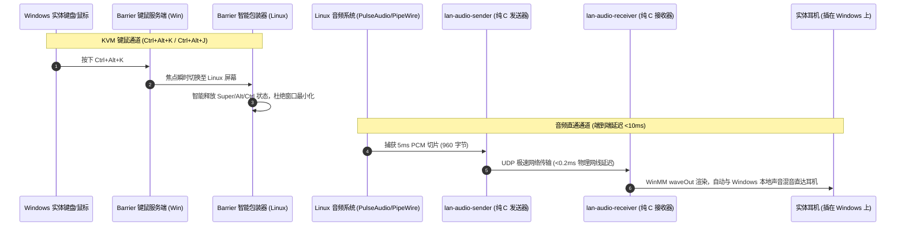

# 局域网双机协同网桥 (`lan-desk-bridge`)

[](LICENSE)
[]()
[]()

专为双机办公/开发打造的**键鼠共享 (KVM) + 极低延迟音频直通 (<10ms)** 一体化协同网桥。适用于 Linux 开发机/迷你主机与 Windows 办公笔记本/台式机通过局域网或 2.5G 直连网线共用一套键鼠、显示屏与耳机的完整解决方案。

[English Documentation (README.md)](README.md)

---

## 痛点：传统双机协同的两大硬伤

在双机协同场景下，两台电脑虽然放在同一张桌子上，但往往伴随令人头疼的问题：
1. **键鼠跨屏共享 (KVM) 各种边界 Bug 频发**：
   - **修饰键粘连 / 窗口最小化 Bug**：通过热键切入 Linux 瞬间，系统残留的 `Alt`/`Super` 键无法及时释放，导致一按 Tab 或敲空格就把当前窗口最小化或触发桌面快捷键。
   - **高分屏鼠标卡死死角**：Windows 开启 125%/150%/200% 缩放时，Barrier/Synergy 坐标计算错误，鼠标常被锁死在右下角 `(2559, 1079)` 动弹不得。
   - **大小写按键 (CapsLock) 状态混乱**：两端大小写频繁反向不同步。
2. **两机声音割裂，耳机插拔繁琐**：
   - 键鼠是跨屏了，但 Linux 的声音（B站视频、系统提示音、会议语音）听不到，必须来回拔插耳机或额外买硬件混音器。
   - 第三方软件（AudioRelay、SoundWire）常驻臃肿的 Java/Electron，占用数百兆内存；VoiceMeeter 等虚拟驱动配置繁琐且容易爆音，延迟常在 40~100ms 以上。

---

## 解决方案：LAN Desk Bridge 一体化套件

本项目将**工业级纯 C 超低延迟音频流引擎**与**修复了所有原生缺陷的轻量 KVM 管道**深度整合，打造零负担的双机协同体验：

```text
+-----------------------------------------------------------------------------------------+
|                                  LAN DESK BRIDGE 双机协同一体化套件                       |
+-----------------------------------------------------------------------------------------+
|  [子系统 1: 纯 C 局域网极低延迟音频网桥]                                                    |
|    - 100% 纯 C 编写，零 Python/Electron/Java 运行库依赖                                   |
|    - Linux 发送端：自动捕获 PulseAudio/PipeWire 混音监视器 (@DEFAULT_MONITOR@)             |
|    - Windows 接收端：调用 WinMM waveOut 硬件混音，直接输出到当前耳机 (免装任何第三方声卡驱动)  |
|    - 5ms 超小切片 (960B) + UDP 直推 (<0.2ms 网线延迟)，真实端到端总延时 <10ms，音画完全同步  |
|    - 内置声卡晶振漂移自适应平滑控制，杜绝连续运行数周产生积压或杂音                         |
+-----------------------------------------------------------------------------------------+
|  [子系统 2: 零缺陷 KVM 键鼠与剪贴板热键共享]                                                |
|    - 预配置 Barrier 核心参数，支持毫秒级无感热键穿梭：                                     |
|        Ctrl + Alt + K  -->  一键切入 Linux 辅机                                         |
|        Ctrl + Alt + J  -->  一键切回 Windows 主机                                       |
|    - X11 智能包装器：切屏瞬间毫秒级释放 Super/Alt/Ctrl 虚按状态，智能对齐 CapsLock 状态      |
|    - Windows 注册表 DPI 补丁：彻底根治高分屏缩放下鼠标卡在屏幕右下角的历史顽疾                 |
+-----------------------------------------------------------------------------------------+
|  [子系统 3: 24/7 静默自启与一键维护]                                                      |
|    - Linux 端：通过 Systemd 用户服务托管，登录自动常驻，崩溃自动秒级拉起                    |
|    - Windows 端：通过任务计划程序 + VBScript 托管，后台完全静默运行，绝无任何烦人黑框控制台   |
|    - 桌面一键重载：Windows 桌面一键图标「重启双机协同(键鼠+音频).bat」，双击即完成重启同步    |
+-----------------------------------------------------------------------------------------+
```



---

## 性能实测与内存消耗

两机双向协同全力运行时，系统资源占用对比：

| 指标 | LAN Desk Bridge (本项目) | AudioRelay + Barrier 官方客户端 | VoiceMeeter + Synergy |
| :--- | :--- | :--- | :--- |
| **音频端到端延迟** | **~7 - 10 ms (完全无感)** | 40 - 80 ms | 25 - 60 ms |
| **Linux 端总内存** | **约 3.9 MB** (音频 1.3M + 键鼠 2.6M) | 180 MB | 无原生客户端 |
| **Windows 端总内存**| **约 29 MB** (音频 12M + 键鼠 17M) | 165 MB | 90 MB |
| **CPU 占用** | **< 0.1%** | 2.5 - 4.5% | 2.0 - 4.0% |
| **是否需额外声卡驱动**| **完全不需要** (原生 WinMM) | 需要 | 需要安装 VB-Cable 驱动 |
| **控制台弹窗** | **完全无窗口静默常驻** | 有图形或托盘残留 | 托盘常驻 |

---

## 项目目录结构

```text
lan-desk-bridge/
├── audio/                          # 纯 C 语言极低延迟音频子系统
│   ├── include/
│   │   └── protocol.h              # 音频网络协议头结构定义
│   └── src/
│       ├── sender_linux.c          # Linux 桌面声音监听捕获发送器
│       └── receiver_win.c          # Windows WinMM 硬件混音接收器
├── kvm/                            # 键鼠与修饰键同步子系统
│   ├── config/
│   │   └── barrier.conf            # 已调优的 Barrier 服务端配置文件 (含热键与半双工配置)
│   ├── scripts/
│   │   ├── barrier-client-wrapper.sh # X11 切屏瞬时释放修饰键与 CapsLock 智能对齐包装脚本
│   │   └── fix_mouse_dpi.reg       # Windows 高分屏鼠标死角修复注册表补丁
│   └── service/
│       └── barrier-client.service  # Linux 用户级 Systemd 服务单元
├── scripts/                        # 统一维护与一键部署脚本
│   ├── install-all-linux.sh        # Linux 端一键全自动安装与启动
│   ├── install-all-windows.bat     # Windows 端一键全自动安装与注册任务
│   ├── restart-dual-pc.bat         # Windows 桌面一键重启双机共享快捷工具
│   ├── restart-dual-pc.sh          # Linux 端一键重启全套服务
│   ├── lan-audio-sender.service    # 音频发送端 Systemd 服务单元
│   └── run_hidden.vbs              # Windows 无黑框静默运行辅助脚本
├── Makefile                        # 跨平台构建 Makefile (支持 Linux + MinGW 交叉编译)
├── LICENSE                         # MIT 开源许可证
├── README.md                       # 英文完整文档
└── README_CN.md                    # 中文完整文档
```

---

## 快速安装与配置

### 第一步：在 Linux 端编译音频程序

```bash
git clone https://github.com/hsdgb3524-crypto/lan-desk-bridge.git
cd lan-desk-bridge
make all
```

一条命令即可生成：
- `bin/lan-audio-sender`：Linux 原生二进制
- `bin/lan-audio-receiver.exe`：Windows PE 可执行程序

---

### 第二步：Linux 端一键部署

在项目根目录下执行：
```bash
./scripts/install-all-linux.sh
```
该脚本会自动：
1. 检查并安装缺少的环境依赖（`barrier`, `xdotool`, `xset`, `libpulse-dev`）。
2. 将编译好的音频发送器和智能 X11 包装脚本安装至 `/usr/local/bin`。
3. 注册并立即启动 `barrier-client.service` 与 `lan-audio-sender.service` 用户服务。

---

### 第三步：Windows 端一键部署

1. 将编译好的 `bin\lan-audio-receiver.exe` 与 `scripts\` 文件夹拷贝至 Windows。
2. 右键以管理员身份运行 `scripts\install-all-windows.bat`。

该脚本会自动：
1. 将配置文件分别安置在 `D:\Barrier\` 与 `D:\LanAudio\`。
2. 自动导入高分屏鼠标防死角注册表项。
3. 自动开放 Windows 防火墙 TCP 24800 (Barrier) 与 UDP 4010 (音频直通) 端口。
4. 注册 `BarrierServer` 与 `LanAudioReceiver` 两个登录静默自启计划任务（无任何黑框弹窗）。
5. 在 Windows 桌面上自动生成「`重启双机协同(键鼠+音频).bat`」便捷重启图标。

---

## 日常使用与热键一览

| 操作目标 | 触发方式 |
| :--- | :--- |
| **键盘鼠标切入 Linux 开发机** | 键盘按下 `Ctrl + Alt + K` |
| **键盘鼠标切回 Windows 主机** | 键盘按下 `Ctrl + Alt + J` |
| **收听 Linux 开发机的声音** | **完全自动**！Linux 发出的任何声音直接无缝混入 Windows 耳机 |
| **一键重启两机共享服务 (Windows)** | 双击桌面上的「`重启双机协同(键鼠+音频).bat`」 |
| **一键重启两机共享服务 (Linux)** | 终端运行 `./scripts/restart-dual-pc.sh` |

---

## 开源许可证

本项目遵循 [MIT 许可证](LICENSE)。
