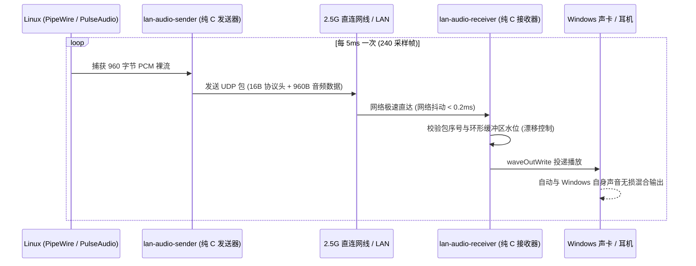

# 局域网超低延迟音频直通网桥 (`lan-audio-bridge`)

[](LICENSE)
[]()
[]()

基于**纯 C 语言**编写的超轻量、极低延迟局域网音频直通方案。专为双机协作场景打造（如 Linux 开发机 + Windows 主机通过直连网线或局域网公用一套耳机/音响）。

[English Documentation (README.md)](README.md)

---

## 为什么需要 LAN Audio Bridge？

在使用双机（Linux 迷你主机 / 工作站 + Windows 笔记本/台式机）搭配 Barrier / Synergy 共享键鼠时，你常会遇到**键鼠已跨屏共享，但两台电脑声音却不得不插拔耳机**的困境。

现有的网络音频方案存在诸多痛点：
- **AudioRelay / SoundWire**：闭源商业软件、高级功能收费、常驻臃肿的 Java 或 Electron 运行时。
- **VoiceMeeter / 虚拟声卡 (VB-Cable)**：驱动配置极其繁琐、容易产生爆音、CPU 占用高。
- **PulseAudio 原生网络模块 / RTP**：缓冲延迟通常在 50~200ms 以上，看视频人声不同步、敲代码提示音有迟滞。

**LAN Audio Bridge 的设计哲学与优势：**
- **零沉重依赖**：纯 C 语言编写，底层仅链接系统级轻量 API（Linux 侧 `libpulse-simple`，Windows 侧 WinMM `waveOut`），告别 Python/Electron/Java 运行库。
- **真实 <10ms 超低延迟**：采用 5ms 超小音频切片（960 字节）与无压缩 UDP 直推，直连网线延迟仅 0.2ms，肉眼与双耳完全无法察觉任何延迟。
- **Windows 原生硬件混音**：利用 WinMM 的 `waveOut` 接口直接混入系统默认声卡通道，Windows 会自动将来自 Linux 的声音与 Windows 本地声音混合输出到耳机，**无需安装任何虚拟音频驱动**。
- **时钟漂移自适应平滑处理**：针对两台独立设备晶振时钟微小差异（如 48001Hz vs 47999Hz），内置智能环形缓冲区漂移补偿，杜绝长时间连续运行导致的音频积压或爆音。
- **极简资源消耗**：
  - Linux 发送端内存占用：**约 1.1 MB**，CPU 占用 **< 0.1%**
  - Windows 接收端内存占用：**约 12 MB**，CPU 占用 **< 0.1%**

---

## 系统架构

```text
+-----------------------------+                 +-----------------------------+
|      Linux 发送端 (开发机)    |                 |      Windows 接收端 (主机)   |
|                             |                 |                             |
|  桌面所有发声程序             |                 |  WinMM waveOut 渲染引擎     |
|            |                |                 |            |                |
|  PulseAudio / PipeWire      |                 |  Windows 硬件共享混音器      |
|  (@DEFAULT_MONITOR@ 监听)   |                 |            |                |
|            |                |   2.5G 直连网线  |            v                |
|  lan-audio-sender (纯 C)    |   UDP :4010     |  lan-audio-receiver.exe     |
|  - 48kHz, 16-bit, 双声道    | --------------> |  - 32 槽环形动态缓冲池      |
|  - 5ms 切片 (960B PCM)      |    < 0.2ms 延迟 |  - 时钟漂移实时平滑控制      |
|  - 单调递增包序校验与时间戳   |                 |  - 直通输出至当前默认耳机     |
+-----------------------------+                 +-----------------------------+
```



---

## 性能实测对比

| 指标 | LAN Audio Bridge | AudioRelay | VoiceMeeter + VBAN |
| :--- | :--- | :--- | :--- |
| **端到端总延迟** | **~7 - 10 ms** (无感) | 40 - 80 ms | 25 - 50 ms |
| **Linux 端内存** | **1.1 MB** | 120 MB (Electron) | 无原生 Linux 端 |
| **Windows 端内存** | **12 MB** | 85 MB | 45 MB |
| **CPU 占用** | **< 0.1%** | 1.5 - 3.0% | 1.0 - 2.5% |
| **是否需额外声卡驱动** | **完全不需要** | 需要 | 需要安装 VB-Cable 驱动 |
| **开源许可证** | **MIT (完全开源)** | 商业闭源 / 限制免费 | 免费捐助 / 闭源 |

---

## 快速使用

### 1. 源码编译

依赖：
- Linux 端：`gcc`, `make`, `libpulse-dev`
- Windows 交叉编译（可在 Linux 上直接完成）：`mingw-w64` (`x86_64-w64-mingw32-gcc`)

```bash
# 获取源码
git clone https://github.com/hsdgb3524-crypto/lan-audio-bridge.git
cd lan-audio-bridge

# 一键同时编译 Linux 发送端与 Windows 接收端
make all
```

编译生成文件位于 `bin/` 目录：
- `bin/lan-audio-sender`：Linux 原生二进制
- `bin/lan-audio-receiver.exe`：Windows PE 可执行程序

---

### 2. 手动前台调试运行

#### Windows 接收端：
```cmd
lan-audio-receiver.exe -p 4010 -b 32
```

#### Linux 发送端：
```bash
./bin/lan-audio-sender -t <Windows的IP地址> -p 4010
```

---

### 3. 开机自启与后台静默运行

#### Linux 发送端（Systemd 用户级服务）：
运行内置的一键部署脚本：
```bash
./scripts/install-linux-service.sh
```
该脚本会将编译出的二进制安装至 `/usr/local/bin`，注册并激活 `lan-audio-sender.service`，后续 Linux 开机登录自动常驻。

#### Windows 接收端（计划任务无窗口静默常驻）：
1. 将 `bin\lan-audio-receiver.exe` 和 `scripts\run_hidden.vbs` 拷贝至 `D:\LanAudio\`。
2. 右键以管理员身份运行 `scripts\install-windows-task.bat`。
3. 系统将自动放行防火墙 UDP 4010 端口，并创建 `LanAudioReceiver` 计划任务，用户登录后自动以无黑框窗口模式在后台静默运行。

---

## 命令行参数一览

### 发送端 (`lan-audio-sender`):
```text
用法: lan-audio-sender [选项]
选项:
  -t, --target <ip>      接收端 IP 地址 (默认: 169.254.123.131)
  -p, --port <port>      UDP 目标端口 (默认: 4010)
  -d, --device <name>    PulseAudio 采集设备 (默认: @DEFAULT_MONITOR@ 桌面混音监听)
  -r, --rate <hz>        音频采样率 (默认: 48000 Hz)
  -f, --frames <count>   每包音频采样帧数 (默认: 240 帧，约 5ms)
  -v, --verbose          开启详细统计日志输出
  -h, --help             查看帮助文档
```

### 接收端 (`lan-audio-receiver.exe`):
```text
用法: lan-audio-receiver.exe [选项]
选项:
  -p <port>       UDP 监听端口 (默认: 4010)
  -b <buffers>    环形缓冲区大小 8-128 (默认: 32 个槽位)
  -v              开启详细调试与丢包统计
  -h              查看帮助文档
```

---

## 许可证

本项目遵循 [MIT 许可证](LICENSE)。
